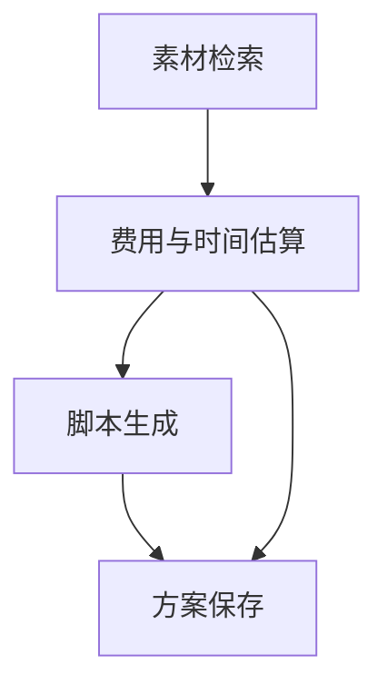

# 十二类要求自检

## 本轮结论

本轮核对前，费用硬校验、幂等与失败续跑已有测试；计划版本、显式 DAG、标准化工具契约、依赖 blocked、逐项部分成功重试和步骤审计记录存在缺项。本轮已补充对应实现与实际验证。

当前 57 项测试中 54 项通过，3 项本机 HTTP 联测因环境返回 WinError 10013 跳过。18 个验收调用场景各重复 3 次，54/54 验收预期匹配、54/54 结构检查通过。该批量评估采用 mock 控制器。

本次新增两条外部模型逐步决策路径，使用真实工具返回逐轮执行。供应商模型 API 的自动端到端运行仍待凭据与网络条件验证。人工内容质量评分保持待评。

## 逐项对照

| 类别 | 本地实现与核对结果 | 验证入口或材料 |
| --- | --- | --- |
| 1 输入与前置校验 | 支持主题、预算、带时区截止时间，--catalog 可提供合成素材与费用耗时表。缺字段返回 missing_fields 和零工具调用，非法费用拒绝执行 | test_missing_fields_are_structured_and_all_steps_blocked、test_custom_catalog_and_invalid_fee_validation |
| 2 结构化计划 | task_plan 和 plan_versions 提供版本、类型、状态、节点输入、输出类型、依赖、结果引用、预计及实际费用耗时。重规划保留旧版本 | observed/replan.json、test_rejected_plan_and_reused_results_preserved |
| 3 工具契约 | --describe-tools 发布输入、输出、前置条件、幂等声明及统一结果结构。每次结果含 status、cost、duration、output、error | src/content_agent/contracts.py、test_cli_publishes_tool_contracts |
| 4 预算核算 | 账本、调用成本与计划实际成本一致；制作及保存前重新计算。失败、blocked 与复用调用新增费用为零 | test_dag_contracts_accounting_and_snapshots、observed/no_budget.json |
| 5 动态决策 | 成本超限、工具错误、部分成功均有运行记录。replanning 提供触发观察、模型简短依据、版本变化和复用步骤 | observed/audited_live_budget.json、audited_live_error.json、partial_retry.json |
| 6 状态与依赖 | 节点支持 pending、running、retrying、success、partial_success、failed、blocked。工具守卫拒绝依赖不足的调用，保存同时要求脚本和报价 | test_dependency_failure_blocks_actual_save、observed/dependency_blocked.json |
| 7 幂等 | task_id 稳定，run_id 每次调用不同，步骤与尝试提供幂等键。完成任务返回 cached；工具层重复保存和重复补取均复用且零新增费用 | test_run_ids_and_step_keys_with_cached_result、test_direct_save_is_idempotent |
| 8 失败续跑 | 支持脚本失败、保存失败和部分素材中断后续跑。历史失败尝试保持原值，新尝试使用新 attempt_id | observed/resumed.json、retry_completed.json、partial_resumed.json |
| 9 完整交付 | 报告含计划、各版状态、标准化工具结果、费用、保存方案、重规划、调用尝试及快照。unfinished 提供停点、资金/时间/素材缺口、保留结果和建议 | observed/no_budget.json、partial_retained.json、missing_budget.json |
| 10 可观测与审核 | 每步提交账本、尝试、计划和快照。可从 result.cost、spent_after、charges 三方核对费用。旧失败版本与失败尝试保留 | test_failed_attempt_never_changes_to_success、examples/test-results.txt |
| 11 测试验收 | 用户列出的十类场景均覆盖，另外测试旧检查点迁移、非法模型参数、付费脚本禁止重标版本、实际多进程去重 | tests/test_requirements.py、tests/test_agent.py、tests/test_integration.py |
| 12 确定性兜底 | 模型仅返回动作、参数与公开依据。费用、依赖、状态、保存、版本记录、步数和幂等由代码约束；已有付费脚本禁止更换标签 | test_paid_script_cannot_be_relabelled_as_another_plan、test_concurrent_cli_calls_do_not_duplicate_costs |

文件名 observed/ 均相对于 examples/。完整测试名可在 tests/test_requirements.py 中搜索。

## 计划与状态约定

DAG 的典型关系如下。保存还直接依赖已成功的估算。



计划在模型尚未选定版本时保留初始骨架，脚本预计费用为 null，表示待选择。模型首次询价选定初始版本，后续改变候选版本生成 alternative 计划，重复失败操作生成 retry 计划。计划状态 active、rejected、abandoned、incomplete、completed 与节点执行状态分别保存。

四类工具都是核心步骤。部分素材足以支持 lite 时，模型可以明确选择 lite 降级交付，其余未取得素材继续在 asset_failures 中披露。所有后续工具仍通过各自的素材、报价与脚本前置条件校验。

兼容字段 steps 是工具类别的聚合状态。最终成功重试可能使聚合状态为 succeeded，但原失败 attempt 和旧计划的失败节点保持 failed。审核具体失败时应查看 attempts、plan_versions 与 trace。

工具为本地计算，running/retrying 过程记录于 attempt.transitions，完成时把结果、账本与快照一起原子提交。真实远程长任务、远程扣费与过程状态分布式提交仍需扩展协议。

## 部分成功的费用规则

素材检索采用每任务一次的模拟检索包。首次产生可用素材时收取一次检索费用，后续仅补取失败 ID 属于该包，不额外计费或增加模拟制作时间。模型调用的真实耗时由真实时钟继续约束。

item_results 将该包费用归到首次成功项，其余成功项和失败项费用为零。失败项明确保留 status=failed 与错误码。工具返回 partial_success，成功素材保留；重试时只请求 failed_asset_ids，原失败记录保持原值。

此规则是合成业务协议，实际按次计费工具须相应扩展费用表与账本。

## 可复制验证

```powershell
python -m src.content_agent --describe-tools
python -m unittest discover -s tests -v
python examples/reproduce.py
python -m examples.evaluate --repeats 3 --out .runtime/audit-evaluation
```

部分成功及续跑的单独入口如下。

```powershell
python -m src.content_agent examples/inputs/partial_resume.json --partial-once --max-steps 1 --db .runtime/partial.sqlite --as-of 2030-05-01T09:00:00+08:00 --out .runtime/partial-first.json
python -m src.content_agent examples/inputs/partial_resume.json --resume --partial-once --db .runtime/partial.sqlite --as-of 2030-05-01T09:00:00+08:00 --out .runtime/partial-resumed.json
```

第一轮费用为 1，状态未完成，成功素材已保存。第二轮只补取失败素材，再估算、制作和保存，新执行四步，总费用为 12。

## 待验证边界

- 真实供应商模型 API 仍无自动端到端运行记录，HTTP 联测受本机网络权限限制。
- 人工方案质量评分待完成，模板脚本的创意和真实业务转化尚未验证。
- 远程工具部分扣费、远程不可撤销副作用和生产运行中断恢复尚未覆盖。
- 旧检查点可从原始 Trace 和账本重建审计投影，标记 audit_migrated。该重建不代表历史时刻已存在这些计划快照。
